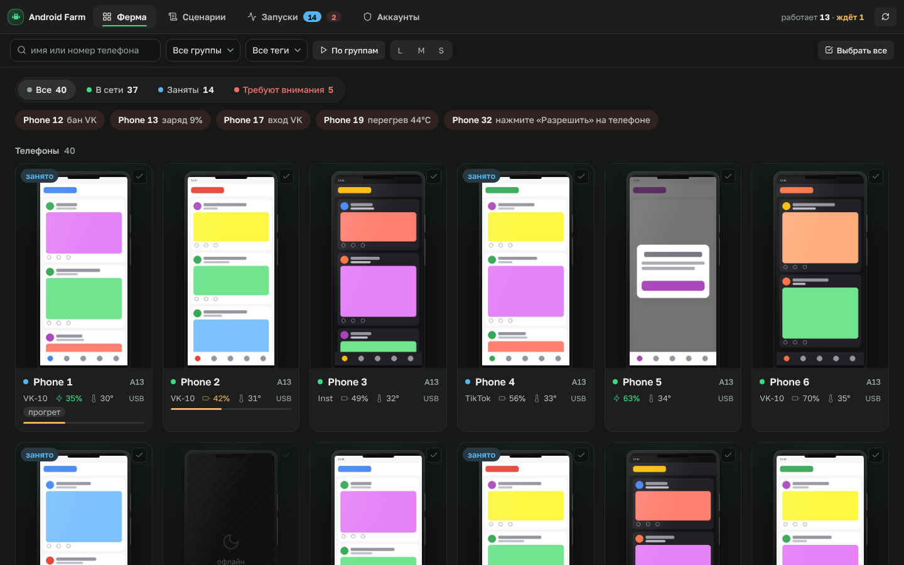
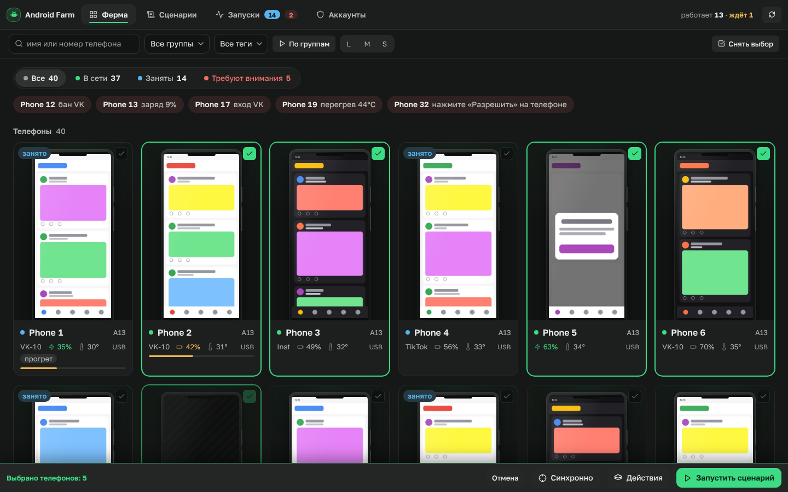
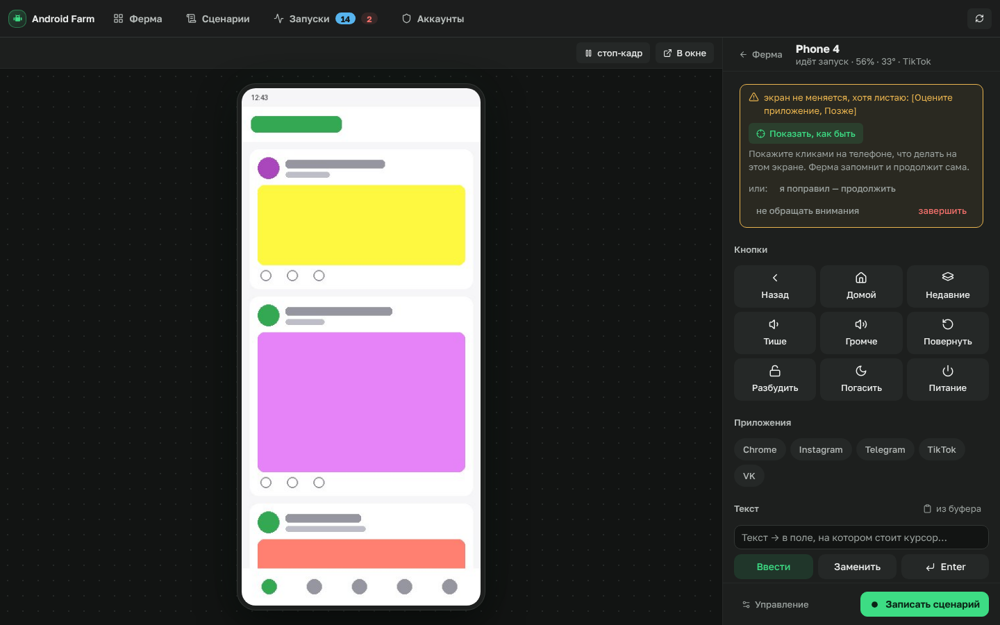
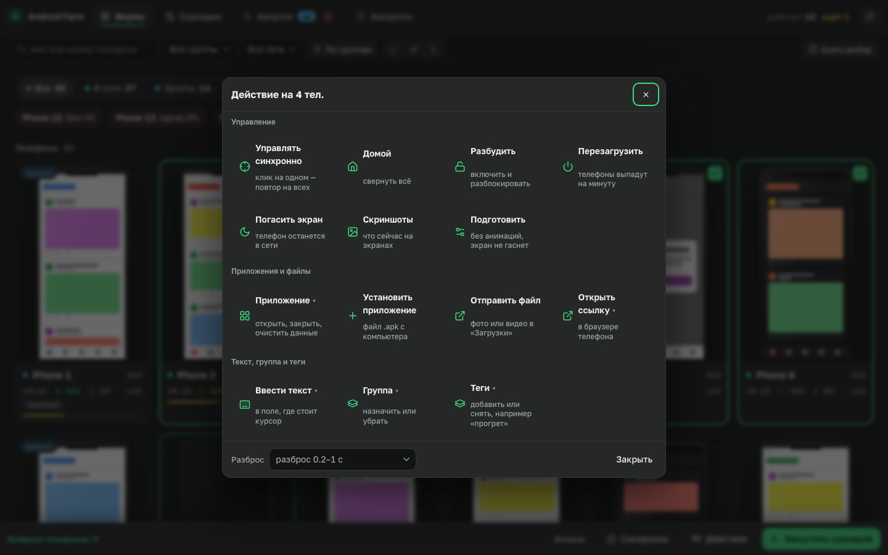
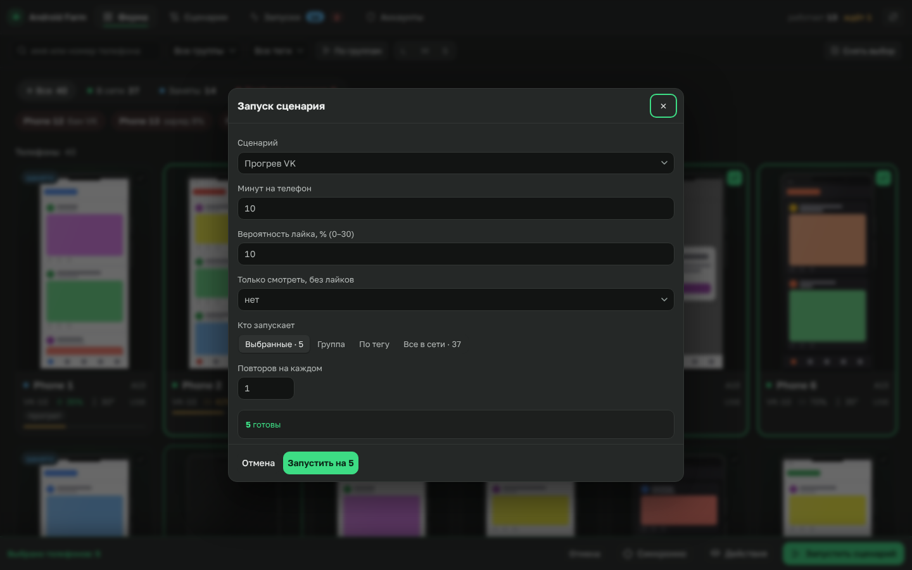
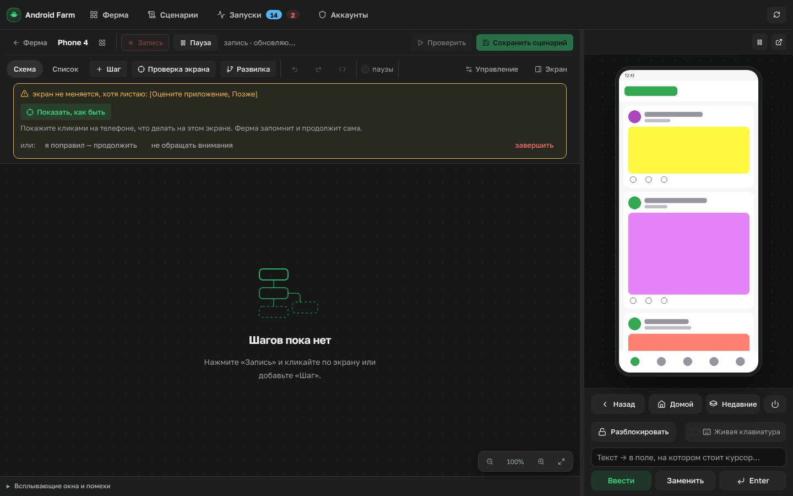
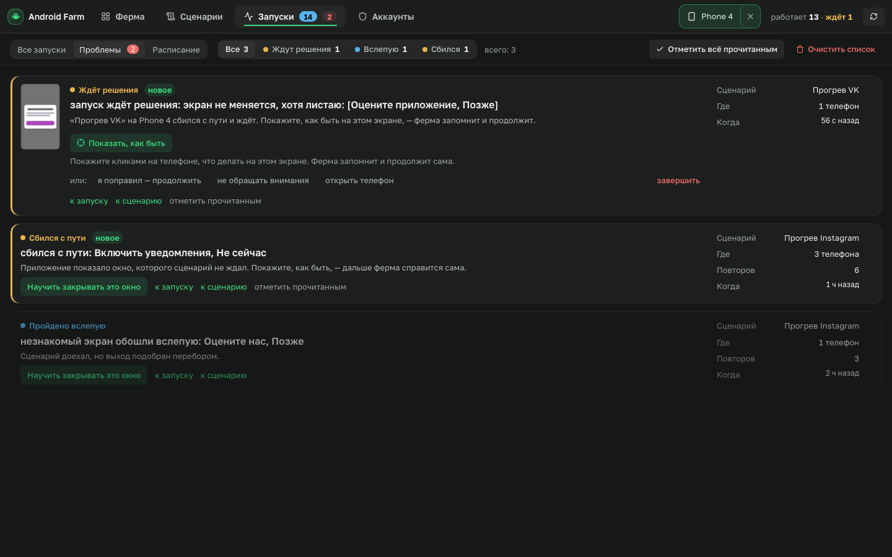
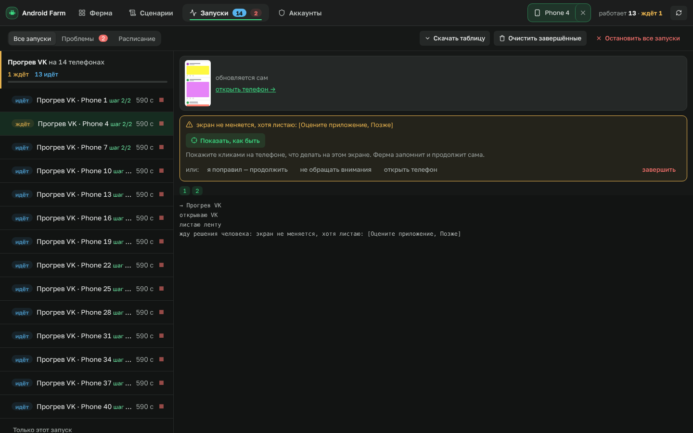
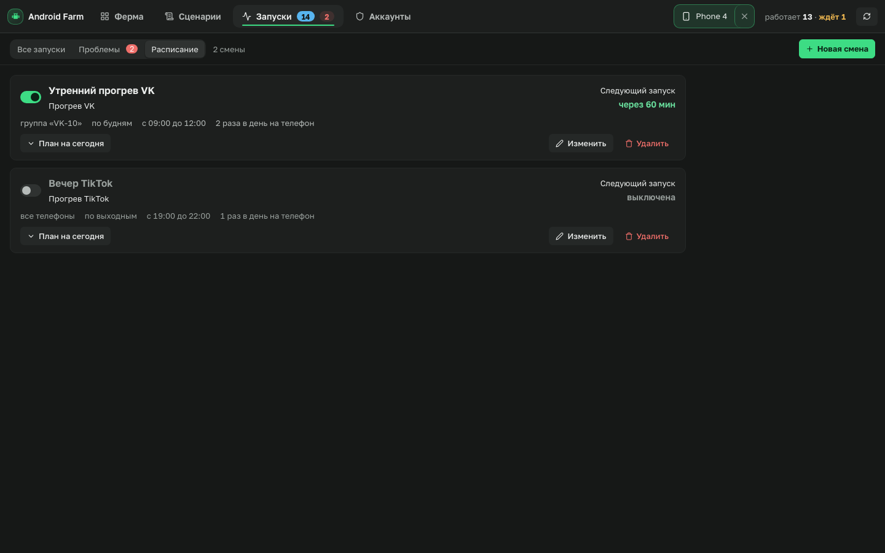

# Android Farm

Локальная ферма Android-телефонов. Подключаете телефоны по USB или по сети,
видите все экраны в браузере, управляете мышью, записываете сценарии кликами
и запускаете их сразу на десятках телефонов. Если что-то пошло не так, ферма
останавливается и спрашивает вас, а показанное запоминает.



## Что умеет

| | |
|---|---|
| **Ферма** — все телефоны плитками с живыми превью, фильтры, группы, теги, «Требуют внимания» по именам | **Пульт телефона** — экран во всю высоту, кнопки, приложения, текст из буфера, файлы перетаскиванием, скриншот и видео |
|  |  |
| **Массовые действия** — синхронное управление, установка APK, файлы, текст, перезагрузка, с разбросом по времени | **Запуск** — сценарий на выбранных, группе, теге или всех; проверка готовности до старта |
|  |  |
| **Конструктор** — сценарий записывается кликами по экрану, правится списком шагов | **Проблемы** — ферма сбилась и ждёт: «Показать, как быть» учит её на месте |
|  |  |
| **Запуски** — по пачкам, с живым экраном и журналом | **Расписание и аккаунты** — смены по дням и окнам, аккаунты с раздачей по телефонам |
|  |  |

## Быстрый старт

**Mac / Linux:** `./run.sh`  **Windows:** двойной клик по `run.bat` (в PowerShell — `.\run.bat`).

Скрипт сам поставит то, чего не хватает, и только один раз: Python 3.10+
(Homebrew на Mac, winget или python.org на Windows), adb и scrcpy (в папку
`.deps`), зависимости (в `.venv`, заново — только если поменялся
`backend/requirements.txt`). Уже установленное повторно не качается.
Ферма откроется на http://127.0.0.1:8777.

Первый запуск создаст `.venv` и поставит зависимости. На телефоне:
**Настройки → О телефоне → 7 раз «Номер сборки»**, затем **Для разработчиков →
Отладка по USB**, при подключении — «Разрешить».

## Как устроен проект

Проект разделён на две независимые части. Сервер ничего не знает о вёрстке,
сайт ничего не знает о телефонах: они общаются только через HTTP API `/api/*`.

```
android-farm/
├── backend/            сервер на Python (FastAPI)
│   ├── farm/           код сервера: API, телефоны, очередь запусков, сценарии
│   ├── scenarios/      сценарии — обычные .py-файлы с функцией run(ctx)
│   ├── guards/         стражи: какие всплывающие окна закрывать самим
│   └── tests/          850+ тестов, телефоны для них не нужны
├── frontend/           сайт: HTML + CSS + JS без сборки, работает без интернета
│   ├── design/         дизайн-система: токены цветов, шрифтов, отступов
│   ├── strings/ru.json все тексты интерфейса
│   ├── css/  js/       стили и модули по разделам
│   └── dev_server.py   сайт отдельно от сервера (если нужно)
├── data/               рабочие данные: аккаунты, имена телефонов, артефакты (не в git)
└── docs/               документация и скриншоты
```

```
 Браузер ──HTTP──▶  frontend/  (статика)
    │
    └──── /api/* ──▶ backend/farm/api      ← тонкий слой: проверить запрос, вызвать сервис
                        │
                        ▼
                     сервисы: devices/ (реестр, очередь), scenarios, schedule, accounts
                        │
                        ▼
                     control/ + adb.py      ← единственное место, где говорим с телефонами
                        │
                        ▼
                     📱 телефоны (USB / TCP)
```

Подробно: [архитектура](docs/architecture.md) · [сервер](docs/backend.md) ·
[сайт](docs/frontend.md) · [дизайн-система](docs/design-system.md) ·
[руководство по механизмам](docs/guide.md) · [грабли](docs/GOTCHAS.md)

## Запуск по частям

```bash
./run.sh                                         # всё вместе (обычный режим)

# сервер отдельно — только API
FARM_SERVE_FRONTEND=0 ./run.sh

# сайт отдельно, ходит в API через прокси
python3 frontend/dev_server.py                   # http://127.0.0.1:5173
FARM_API=http://10.0.0.2:8777 python3 frontend/dev_server.py
```

## Разработка

```bash
cd backend && ../.venv/bin/python -m pytest -q   # тесты сервера и JS-логики
node docs/tools/screenshots.js                   # переснять скриншоты документации
```

Правила, которые держат проект простым:

- **Текст интерфейса** — только в `frontend/strings/ru.json`; в разметке
  `data-t="раздел.ключ"`, в JS `t('раздел.ключ')`.
- **Цвета и размеры** — только токены из `frontend/design/tokens.css`.
- **Новое действие с телефоном** — одна функция в `ACTIONS`
  (`backend/farm/api/screen.py`): его сразу получают пульт, массовые действия
  и синхронное управление.
- **Сценарий** — файл в `backend/scenarios/` с `run(ctx)`; что умеет `ctx` —
  в [руководстве](docs/guide.md#что-умеет-ctx).
# ferma
