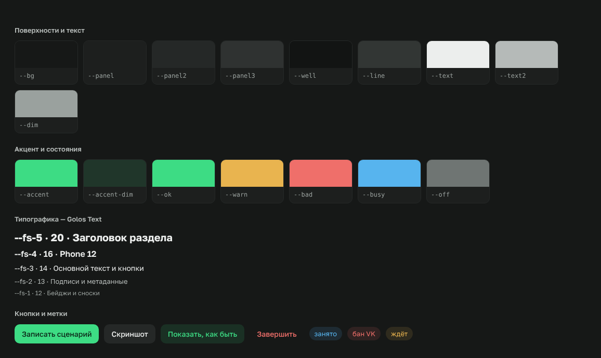

# Дизайн-система

Интерфейс собран из трёх ресурсов. Компоненты сами ничего не выдумывают:
цвет берут из токенов, текст — из строк, иконку — из спрайта.

| Ресурс | Файл | Правило |
|---|---|---|
| Токены | `frontend/design/tokens.css` | только `var(--…)`, никаких hex и px-кеглей в компонентах |
| Строки | `frontend/strings/ru.json` | никакого русского текста литералом в разметке и JS |
| Иконки | `frontend/icons.svg` | Lucide, `<svg class="ic"><use href="#i-имя"/></svg>` |



## Принципы

- **Спокойная норма, громкие исключения.** Нормальное состояние серое; цвет —
  только у действий и у того, что требует внимания. Сорок одинаково зелёных
  плиток спрятали бы ту одну, что сломалась.
- **Одна главная кнопка на панель** (`.primary`, зелёная заливка). Остальные —
  мягкие заливки без рамок.
- **Опасное — красным текстом**, рамка и заливка появляются только на
  наведении или при «взведённом» втором клике (`armConfirm`).
- **Для людей 40+:** ничего мельче 12px, крупные цели для мыши, тексты
  словами, без технических терминов.
- **Работает без интернета:** шрифт Golos Text и иконки лежат локально.

## Токены

### Цвет

| Токен | Значение | Где |
|---|---|---|
| `--bg` | фон страницы | |
| `--panel` · `--panel2` · `--panel3` | слои поверхностей, выше — светлее | карточки, кнопки, наведение |
| `--well` | «колодцы» | поля ввода, логи, холст экрана |
| `--line` · `--line-soft` · `--line-hover` | рамки и разделители | |
| `--text` · `--text2` · `--dim` | текст: основной, вторичный, приглушённый | |
| `--accent` (+ `-dim`, `-line`, `-ink`, `-fill`) | Android-зелёный | главное действие, «в сети» |
| `--ok` · `--warn` · `--bad` · `--busy` · `--off` | состояния | готово · внимание · ошибка · занят · не в сети |

### Типографика

| Токен | Размер | Где |
|---|---|---|
| `--fs-1` | 12px | бейджи, сноски |
| `--fs-2` | 13px | подписи, метаданные, маленькие кнопки |
| `--fs-3` | 14px | основной текст, кнопки |
| `--fs-4` | 16px | заголовки блоков, имя телефона |
| `--fs-5` | 20px | заголовки разделов |
| `--lh` | 1.55 | межстрочный |
| `--sans` / `--mono` | Golos Text / системный моно | моно — только код и логи |

### Отступы, радиусы, движение

| Токены | Значения |
|---|---|
| `--s1`…`--s6` | 4 · 8 · 12 · 16 · 24 · 32 px |
| `--r1` · `--r2` · `--r3` · `--pill` | 6 · 10 · 14 px · полностью круглый |
| `--fast` · `--mid` · `--slow` | 120 · 200 · 320 мс |
| `--ease-out` · `--ease-in` · `--spring` | появление · уход · «прилёт» по действию |

`prefers-reduced-motion` глушит анимации глобально.

## Компоненты

| Класс | Что это |
|---|---|
| `button` · `.sm` · `.primary` · `.accent` · `.ghost` · `.danger` | кнопки: обычная, маленькая, главная, акцентная, тихая, опасная |
| `.key` | клавиша телефона (пульт, панель под экраном) |
| `.chip` · `.chips` | переключатели и метки |
| `.emptybig` | пустое состояние: рисунок, заголовок, строка, кнопка |
| `.toast` | сообщение снизу |
| `#modal .sheet` | диалог |
| `.fmt` | формат строки (`логин:пароль`) плашками |

## Строки

Ключ — `раздел.имя_латиницей`: `fleet.vybrat_vse`, `pult.zapisat_stsenariy`.
Разделы: `nav`, `fleet`, `device`, `pult`, `scen`, `jobs`, `problems`,
`schedule`, `accounts`, `modal`, `common`, `notify`.

```html
<button data-t="fleet.vybrat_vse">Выбрать все</button>
<input data-t-placeholder="fleet.imya_ili_nomer_telefona" placeholder="…">
```

```js
toast(t('pult.video_sohraneno'), 'ok');
t('pult.prodolzhit_zapis', {n: 3});     // "Продолжить запись ({n})" → "Продолжить запись (3)"
```

Текст внутри тега — запасной вариант и подсказка для того, кто читает разметку;
на экран идёт строка из `ru.json`. Тест `backend/tests/test_strings.py`
проверяет: все ключи есть, текст разметки совпадает с `ru.json`, лишних строк нет.

> Перенос текстов идёт постепенно: вся разметка `index.html`, пульт и
> уведомления уже на ключах; в остальных JS-модулях часть сообщений ещё
> литералами. Правило для нового кода — только через `t()`.
